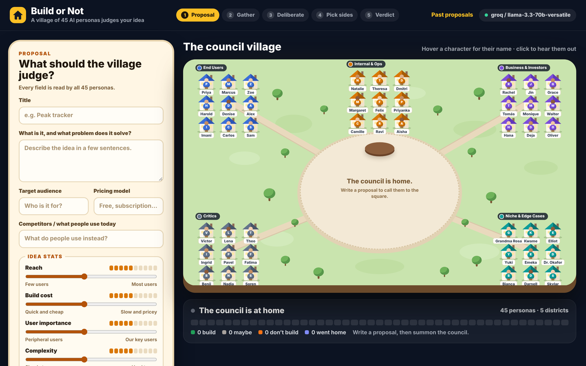
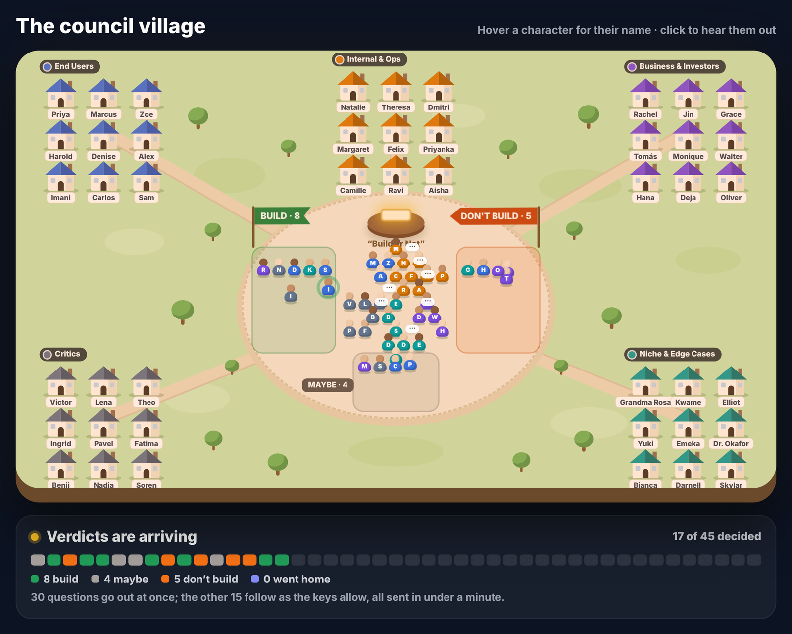
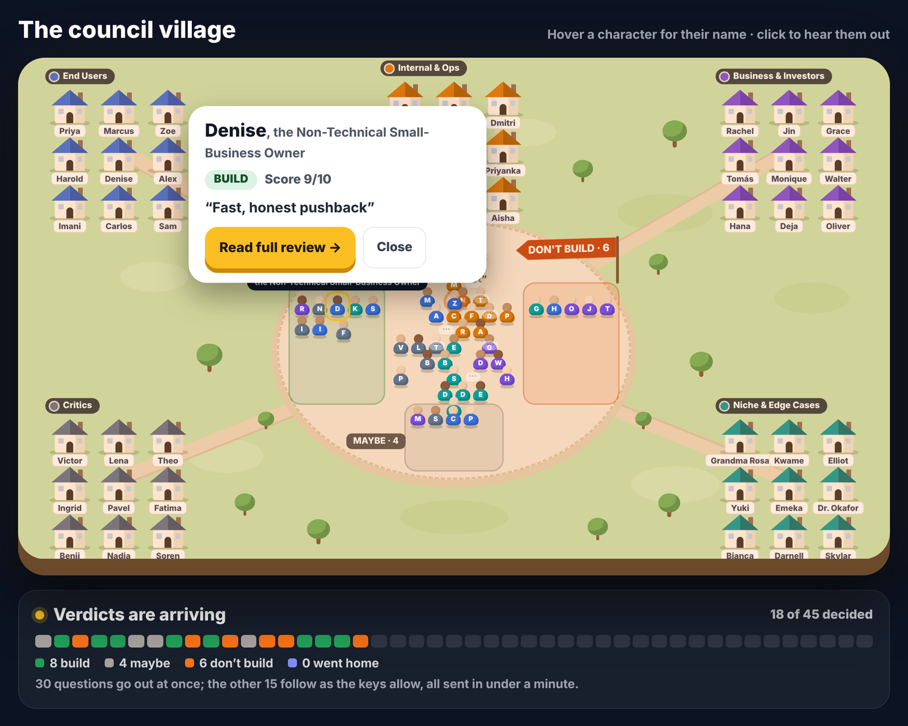
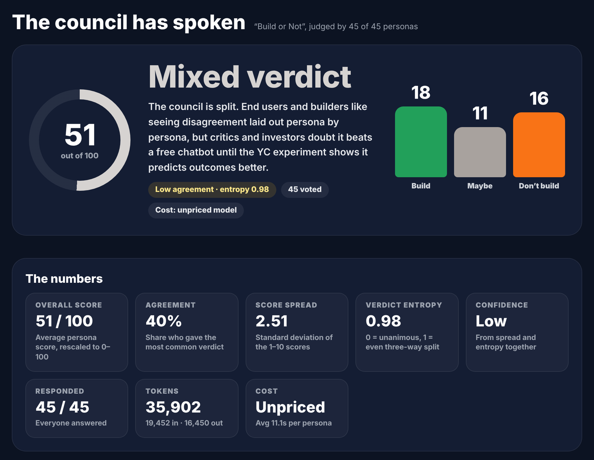
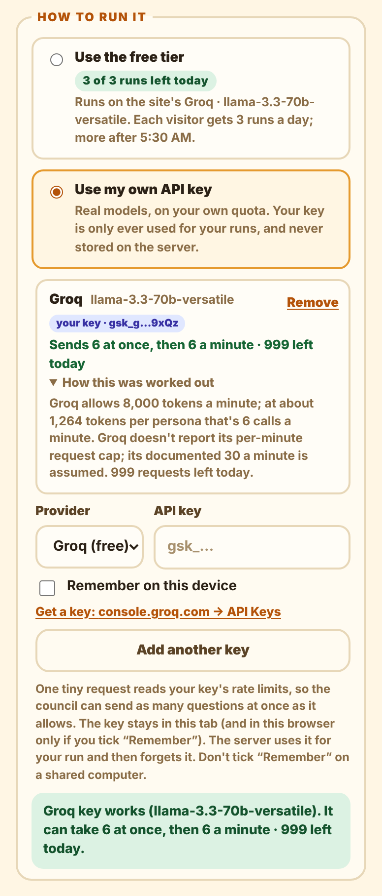

# Build or Not

**45 AI personas judge your startup idea, each on its own, and show you where they disagree.**



## What it is

You describe an idea. A council of 45 fixed personas judges it: end users, investors, critics, edge-case
users, and the people who'd have to build and support it. Each persona answers in its **own,
independent** AI call, so nobody anchors on anyone else. You get a Build / Maybe / Don't build verdict,
and more usefully, *who* disagreed and why.

In a hurry? Click **Just type your idea**, write one sentence, and the AI fills in the whole brief
(description, audience, pricing, competitors and the six idea stats) before the council runs.

It's also an experiment. An eval mode runs the council over YC companies whose outcome is known and
measures whether 45 independent judges actually predict better than a single prompt.

## How it looks

<table>
  <tr>
    <td width="50%"></td>
    <td width="50%"></td>
  </tr>
  <tr>
    <td><b>The council meets.</b> On submit, everyone walks to the square. As each verdict arrives, that character walks to their side.</td>
    <td><b>Every voice is readable.</b> Click anyone for their verdict and short take, then their full review.</td>
  </tr>
</table>



**Results that show disagreement:** overall score, agreement, score spread, verdict entropy and
confidence, plus recurring concerns, scores by persona group and by model, and every individual score.

<table>
  <tr>
    <td width="38%"></td>
    <td>
      <b>Free tier or your own key.</b><br><br>
      Every visitor gets 3 free runs a day on the site's key. Or paste your own key: it's used only for
      your run and never stored.<br><br>
      Either way the app reads the key's real rate limits first. A free Groq key allows 8,000 tokens a
      minute, so the council sends 6 questions at once and paces the rest instead of hitting a wall of
      rate-limit errors.
    </td>
  </tr>
</table>

<sub>Screenshots are from a demo run with simulated answers.</sub>

## How it works

- **45 independent calls per idea**, spread over one model or several (Groq, OpenRouter, Gemini, OpenAI,
  Anthropic), through a bounded worker pool with retries, backoff and a circuit breaker.
- **Sized to the key.** Before each run it reads the key's real rate limits and sends as many calls at once
  as the key allows, then paces the rest. A free Groq key gets about 6 at once instead of a wall of 429s.
- **Survives failure.** A persona whose call fails "goes home" and explains why. A verdict needs 80% of
  the council, and runs resume after a restart.
- **Safe to put online.** Visitors' keys are scoped to their own run. Free runs are capped per IP per day,
  atomically, in MongoDB. Strict security headers, rate limits, and keys scrubbed from anything stored.

The reasoning behind each choice, written for interview prep, is in [DESIGN.md](DESIGN.md).

## Run it

```bash
npm install
docker compose up -d mongo      # or set MONGODB_URI to a free Atlas cluster
npm run dev                     # http://localhost:5174
```

With no API key it runs on simulated models. For real answers, paste a free Groq key on the page or put
`GROQ_API_KEY` in `.env` (see `.env.example`).

## More

- [Full guide](docs/GUIDE.md): setup, providers, troubleshooting, the YC experiment, tests
- [Deploy for free](docs/GUIDE.md#deploy-for-free-render--mongodb-atlas): Render + MongoDB Atlas, step by step
- [Design notes](DESIGN.md): concurrency, rate limits, measuring keys, security
- [Roadmap](docs/ROADMAP.md): what's planned next
- [Sign-in setup](docs/SIGN-IN.md): Google, GitHub and email-code accounts, private runs, how sessions are kept safe

**Stack:** Node.js · Express · TypeScript · MongoDB · React · Vite · Vitest · Docker · Render
